<div align="center">

# 🧪 SplatLab

### *SplatLab: Autonomous Scientific Discovery for 3DGS Research*

**🧪 Turn a one-line prompt (or nothing at all) into a reproduced baseline, a new method, real GPU experiments, and a compiled paper. 🧪**

[](https://neurips.cc/)
[](https://arxiv.org/abs/2610.30468)
[](https://seemandharjain.com/splatlab/)
[](https://arxiv.org/pdf/2610.30468)
[](https://seemandharjain.com/splatlab/demo.html)
[](https://seemandharjain.com/splatlab/#papers)
[](https://github.com/seemandhar/splatify)
[-ff6b35?style=for-the-badge)](https://github.com/seemandhar/nerfify-code)

[](https://docs.anthropic.com/en/docs/claude-code)
[](https://www.python.org/)
[](https://docs.nerf.studio/)
[](https://github.com/nerfstudio-project/gsplat)
[](https://nodejs.org/)
[](LICENSE)

**[Seemandhar Jain](https://seemandharjain.com/) · [Manmohan Chandraker](https://cseweb.ucsd.edu/~mkchandraker/)**

*University of California, San Diego*

### 🏆 Accepted at NeurIPS 2026 🧪

</div>

---

> 🚀 **The research cycle (read, reproduce, extend, train, ablate, write) compressed from months of graduate-student time to days of mostly autonomous compute.**

<p align="center">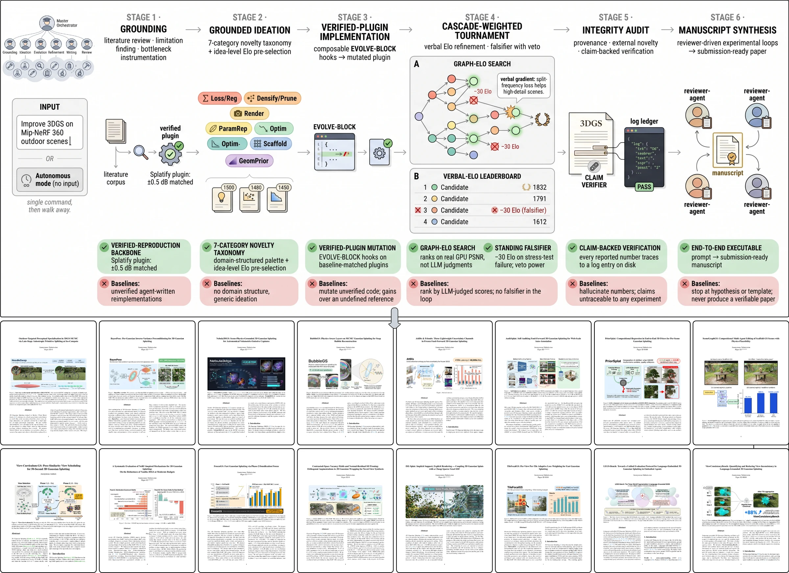</p>

## 📰 News

- **2026-09** — SplatLab is **accepted at NeurIPS 2026**! 🎉
- **2026-10** — Project page, paper PDF, interactive demo, and all 16 SplatLab-written papers are online.
- **2026-06** — **3** SplatLab-written papers accepted by human reviewers at a CVPR 2026 workshop.

## Overview

SplatLab is an autonomous research system for **3D Gaussian Splatting**. You give it a research prompt, a target-paper URL, or no input at all. It reproduces a published baseline, proposes an extension, trains and ablates it across Mip-NeRF 360 and LLFF on real GPUs, writes the manuscript, and **ties every reported number to a logged training run**.

It runs natively on [Claude Code](https://docs.anthropic.com/en/docs/claude-code). One `/research` slash command turns the main session into a lab PI that runs for 24–48 h, dispatching **32 specialised subagents** and coordinating them through a crash-safe `ledger.json`. An optional zero-dependency web dashboard can launch, watch, stop, and resume runs from the browser.

Five design choices set it apart:

| | Design choice | What it buys |
|---|---|---|
| 🧬 | **Verified-reproduction backbone** | No experiment spawns until the target is reproduced within 0.2 dB on our GPUs; every candidate mutates a plugin already matched to its published baseline. |
| 🏆 | **Grounded Elo tournament** | A cascade-weighted Elo tournament across eight islands ranks candidates on *measured* `ns-train` PSNR — never model-judged scores — with verbal-gradient feedback to the ideator. |
| ⚔️ | **In-loop falsification** | Every survivor faces edge-scene, sparse-view, and load-bearing-hyperparameter attacks; each failure subtracts Elo, so robustness is a selection signal. |
| 🔗 | **Claim-backed verification** | A verifier matches every number in the compiled draft to a ledger measurement; the run cannot terminate while any claim is unbacked. |
| 🗺️ | **Domain-aligned modification space** | A seven-category 3DGS taxonomy wraps EVOLVE-BLOCK hooks that an auto-mapper places in any 3DGS repository. |

## Architecture

<p align="center">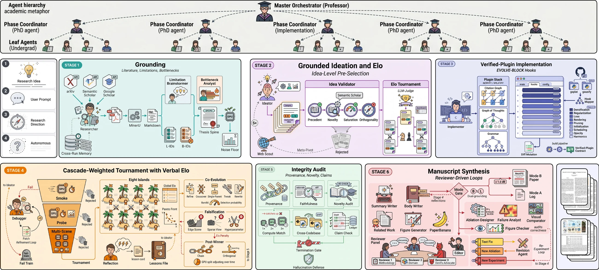</p>

A master orchestrator (the *professor*) delegates to phase coordinators (*PhD students*) and atomic leaf agents (*undergraduates*):

```
Prompt / paper URL / GitHub repo / nothing
  │
  ├─ [1] Grounding ────────── regime classifier · literature corpus + arXiv gap-fill
  │                           repo-reproducer clones + reproduces the target (±0.2 dB)
  │                           evolve-block-mapper places the 9 EVOLVE-BLOCK hooks
  │
  ├─ [2] Grounded ideation ── bottleneck-analyst (empirical B-IDs) + limitation-brainstormer
  │                           (conceptual L-IDs) → ideator + web-idea-scout
  │                           idea-level Elo pre-selection, novelty check, tweak-class ideas banned
  │
  ├─ [3] Implementation ───── implementer: parse → plan → code → review → validate → integrate → test
  │                           debugger / freeform-mutator on failure
  │
  ├─ [4] Tournament ───────── smoke (500 it) → single-scene probe → multi-scene → full 30k
  │                           cascade-weighted Elo · falsifier · 8-island evolutionary search
  │
  ├─ [5] Integrity audit ──── ablation-runner · failure-case-analyst · provenance / novelty / claim checks
  │
  └─ [6] Manuscript ───────── figure-generator · summary/body/related-work writers · latex-assembler
                              3 parallel reviewers → revision-agent until converged → paper.pdf
```

<details>
<summary><b>The research team (32 subagents)</b></summary>

| Stage | Subagents |
|---|---|
| Grounding | `regime-classifier` · `researcher` · `pdf-harvester` · `repo-reproducer` · `evolve-block-mapper` · `baseline-runner` · `benchmark-published` |
| Ideation | `bottleneck-analyst` · `limitation-brainstormer` · `ideator` · `web-idea-scout` · `devils-advocate` |
| Implementation | `implementer` · `debugger` · `freeform-mutator` · `smoke-trainer` · `trainer` |
| Analysis | `ablation-runner` · `failure-case-analyst` · `failure-post-mortem` · `visual-comparator` |
| Writing | `figure-generator` · `summary-writer` · `body-writer` · `related-work-writer` · `supplementary-writer` · `latex-assembler` · `paper-quality-checker` |
| Review | `reviewer-a` · `reviewer-b` · `revision-agent` · `rebuttal-writer` |

Each is a Markdown file with YAML frontmatter in [`.claude/agents/`](.claude/agents/). See [`CLAUDE.md`](CLAUDE.md) for roles, model tiers, and the two execution tracks (A: reproduce + improve a SOTA repo · B: local `gs_template`).

</details>

## Results

Each SOTA row is the target **reproduced on our GPUs** under the reproduce-first contract, not copied from its paper.

| Setting | Method | Limitation attacked / fix | PSNR ↑ | SSIM ↑ | LPIPS ↓ |
|---|---|---|---|---|---|
| **Nebula** (180 fr) | 3DGS | pinhole ignores OPENCV distortion; SfM yields ≈0 stars | 32.58 | 0.914 | 0.278 |
| | **Nebula3DGS-v2** | 3DGS-MCMC sampler + saturation-driven star seeder | **36.36** (+3.78) | **0.945** | **0.201** |
| **Bubble** (200 fr) | 3DGS | SH cannot represent thin-film iridescence | 27.40 | 0.857 | 0.337 |
| | **BubbleGS** | MCMC chassis + Snell/Fresnel two-pass shell renderer | **30.11** (+2.71) | **0.906** | **0.224** |
| **Mip-NeRF 360** (7 sc) | FastGS | {0,1}-thresholded pixel count is frequency-blind | 29.12 | 0.858 | 0.217 |
| | **TileFocalGS** | rank-graded per-tile weights, EMA-smoothed across views | **29.69** (+0.57) | **0.869** | **0.194** |
| **Mip-NeRF 360** (9 sc, 109 s) | FastGS | opacity reset destabilises late refinement | 25.65 | 0.751 | 0.311 |
| | **FreezeGS** | freeze geometry, disable opacity reset in phase 2 | **26.08** (+0.43) | **0.761** | **0.300** |
| **Mip-NeRF 360** (7 sc, 50 s) | splatfacto | severely under-converged at 50 s | 20.53 | 0.593 | 0.505 |
| | **View-Curriculum-GS** | first 15 s on the 30% most pose-similar views | **23.36** (+2.83) | **0.686** | **0.412** |
| **Mip-NeRF 360** | MSAA-3DGS | multi-sample AA blurs fine contrast | 25.35 | 0.758 | 0.369 |
| | **MSAA-Bilat** | bilateral-grid contrast recovery | **26.19** (+0.84) | **0.791** | **0.293** |
| **LLFF** | DWTGS | wavelet basis under-constrained without high-freq supervision | 18.68 | 0.510 | 0.374 |
| | **DWTGS-Patch** | patch structure loss + opacity/normal/depth regularisers | **21.09** (+2.41) | **0.725** | **0.281** |

The full table (11 reproduced targets, 11 wins) is in the [paper](https://arxiv.org/pdf/2610.30468). **3** SplatLab-written papers submitted to a CVPR 2026 workshop were accepted by human reviewers. In a blind expert study, SplatLab ideas scored higher on novelty than PhD-student ideas (5.71 vs 4.92, p = 0.041).

<p align="center">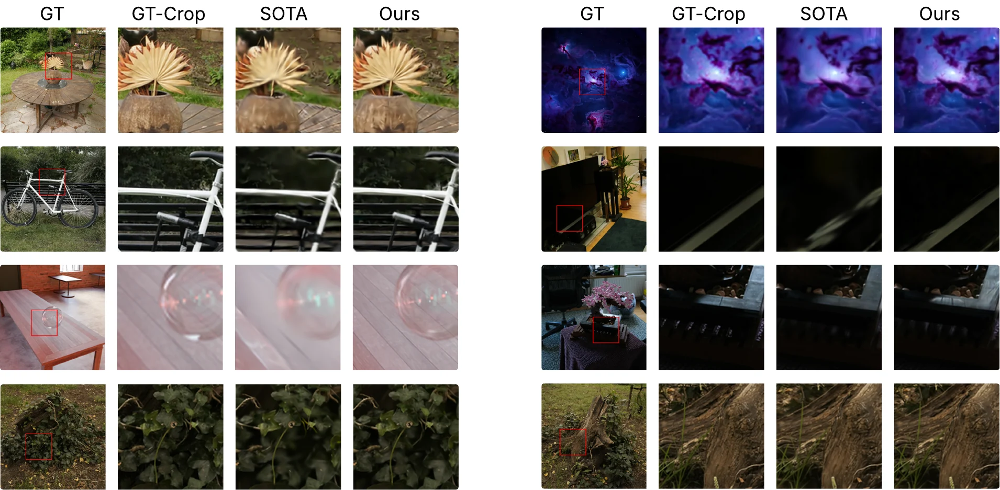</p>

## Papers written by SplatLab

Each first page below comes from a real compiled PDF produced by one autonomous run: the method was invented, trained, ablated, illustrated, written, and revised with no human editing. Click a page to read the paper.

<table>
<tr><td align="center" width="25%"><a href="https://seemandharjain.com/splatlab/static/papers/run_20260501_212753.pdf">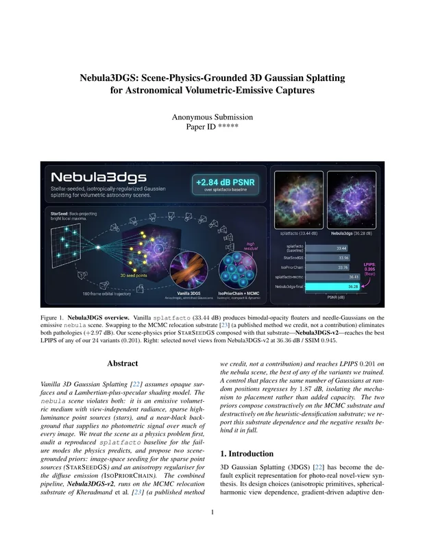</a><br><b>Nebula3DGS</b><br><sub>+3.78 dB</sub></td><td align="center" width="25%"><a href="https://seemandharjain.com/splatlab/static/papers/run_20260502_095036.pdf">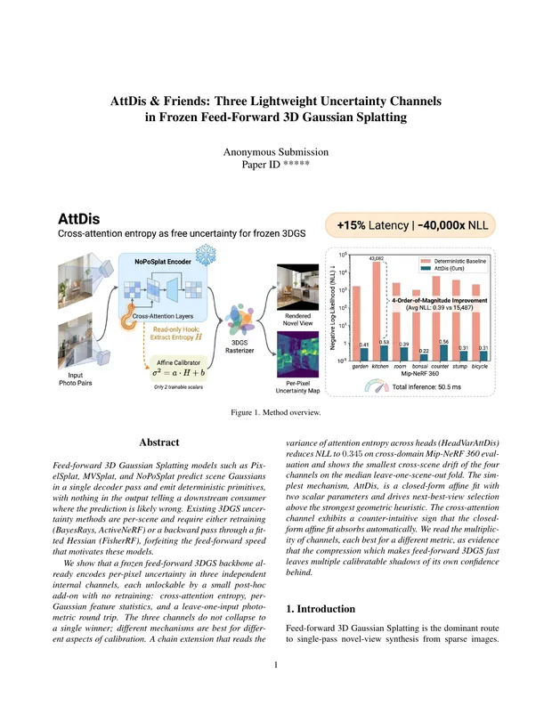</a><br><b>AttDis &amp; Friends</b><br><sub>✅ CVPR’26 WS</sub></td><td align="center" width="25%"><a href="https://seemandharjain.com/splatlab/static/papers/run_20260427_041329.pdf">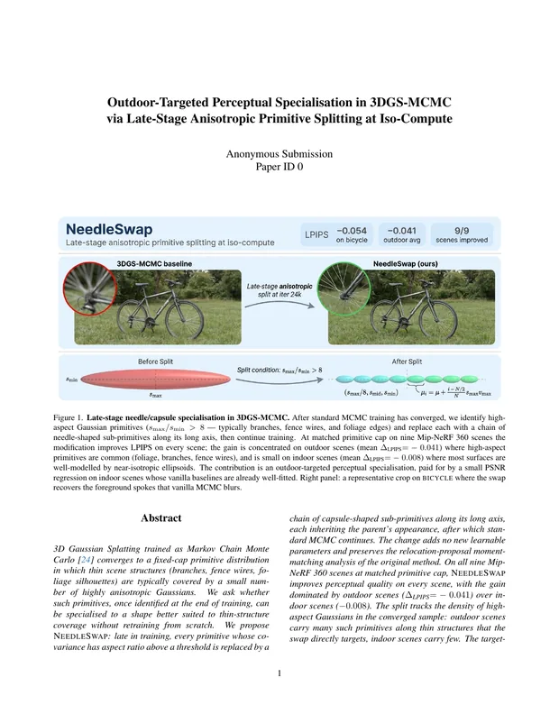</a><br><b>NeedleSwap</b><br><sub>✅ CVPR’26 WS</sub></td><td align="center" width="25%"><a href="https://seemandharjain.com/splatlab/static/papers/run_20260503_050138.pdf">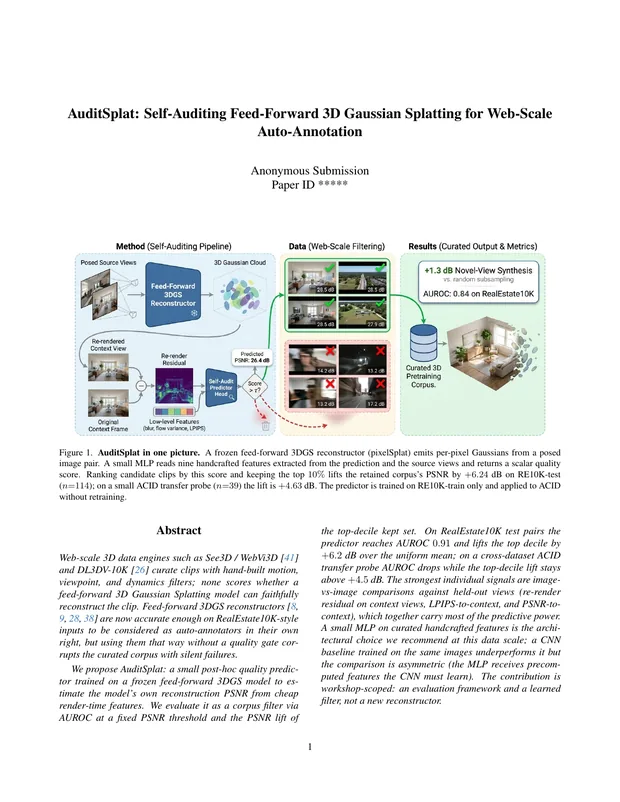</a><br><b>AuditSplat</b><br><sub>✅ CVPR’26 WS</sub></td></tr>
<tr><td align="center" width="25%"><a href="https://seemandharjain.com/splatlab/static/papers/run_20260502_025645.pdf">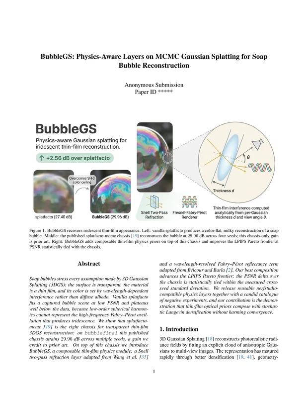</a><br><b>BubbleGS</b><br><sub>+2.71 dB</sub></td><td align="center" width="25%"><a href="https://seemandharjain.com/splatlab/static/papers/run_20260418_225812.pdf">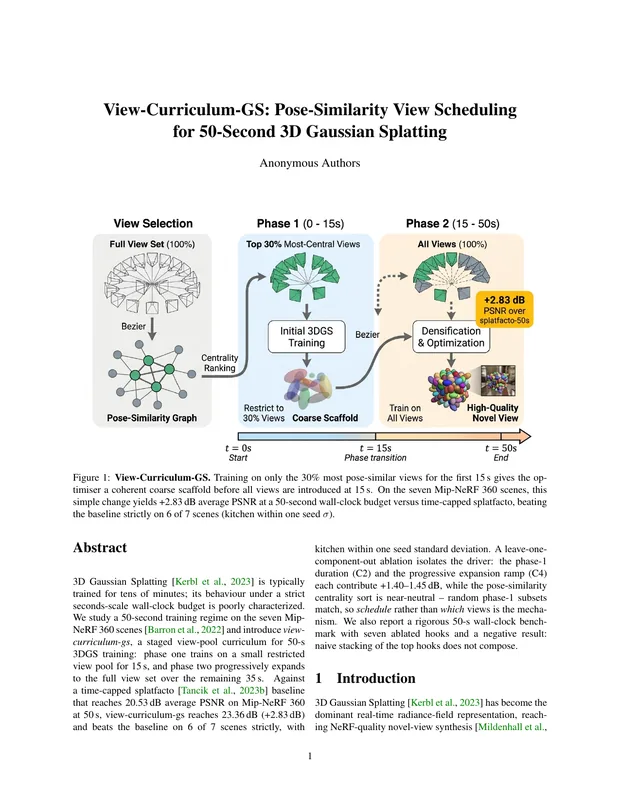</a><br><b>View-Curriculum-GS</b><br><sub>+2.83 dB</sub></td><td align="center" width="25%"><a href="https://seemandharjain.com/splatlab/static/papers/run_20260424_070505.pdf">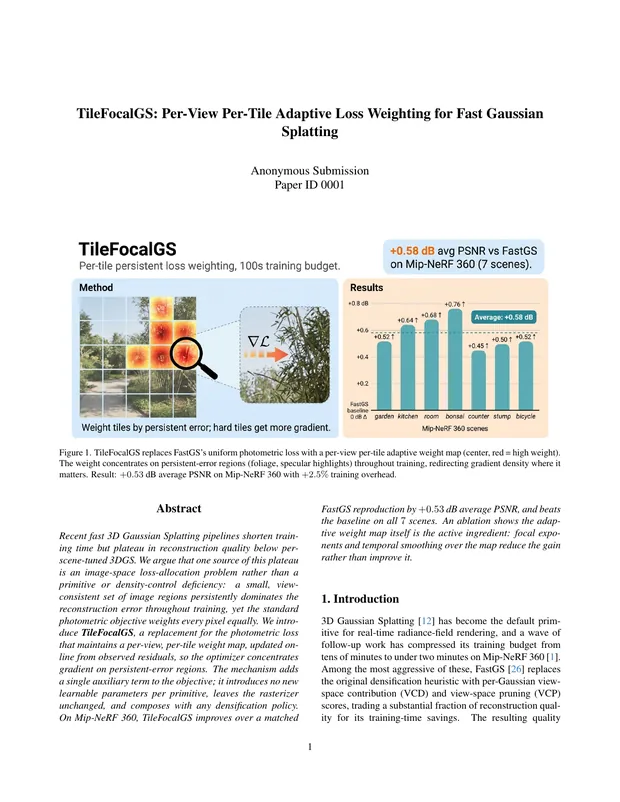</a><br><b>TileFocalGS</b><br><sub>+0.57 dB</sub></td><td align="center" width="25%"><a href="https://seemandharjain.com/splatlab/static/papers/run_20260419_195749.pdf">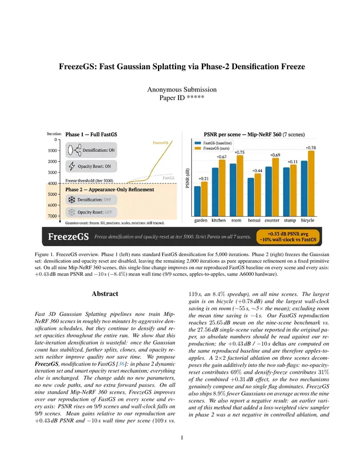</a><br><b>FreezeGS</b><br><sub>+0.43 dB</sub></td></tr>
</table>

All 16 papers, plus the OpenReview decisions, are on the [project page](https://seemandharjain.com/splatlab/#papers).

## Quick Start

### Requirements

- [Claude Code](https://docs.anthropic.com/en/docs/claude-code) (`claude` on PATH) with a Claude Max plan or an API key
- `tmux`, `python3` + `pyyaml`
- For real training runs: CUDA GPU(s), a `nerfstudio` conda env (`ns-train` / `ns-eval`), `mineru` (PDF → Markdown), TeXLive (`pdflatex`, `bibtex`)
- Optional: `node` ≥ 18 for the web dashboard; [PaperBanana](https://github.com/dwzhu-pku/PaperBanana) for figure generation (`export PAPERBANANA_DIR=/path/to/PaperBanana`)

### Install

```bash
git clone https://github.com/seemandhar/SplatLab.git
cd SplatLab

conda create -n nerfstudio python=3.10 -y && conda activate nerfstudio
pip install nerfstudio pyyaml
pip install -e splatify/gs_template        # local nerfstudio-compatible 3DGS template (Track B)

# datasets go under data/ (paths are set in config.yaml → data_roots)
mkdir -p data && ln -s /path/to/mipnerf360 data/mipnerf360
```

### A) Terminal: `/research` (recommended)

The classic way to run SplatLab, and the one used for every run in the paper. Start Claude Code in the repo root and the main session becomes the lab PI:

```bash
claude
> /research "frequency-aware adaptive densification for 3DGS" --hours 24
> /research-status      # live progress: thesis, idea pipeline, best result, budget
> /research-stop        # graceful halt; in-flight experiments finish
> /research-resume      # pick up after a stop or crash, from the ledger checkpoint
```

Fully detached in tmux, so it survives ssh disconnects:

```bash
bash scripts/launch.sh "my idea" 24        # starts claude + /research in a tmux session
tmux attach -t splatlab         # watch the master console
```

Ways to start a run:

```bash
/research "your idea here" --hours 24                                   # from a research prompt
/research "improve it" --paper-url https://arxiv.org/abs/2505.05587     # target a published paper
/research "improve it" --git-url https://github.com/<org>/<3dgs-repo>   # clone + reproduce a repo first
/research --hours 24                                                    # no idea given: falls back to config.yaml
```

Other flags: `--scenes a,b,c`, `--max-budget-usd N`, `--model-preset optimized|all_opus|all_sonnet`.

### B) Web dashboard (alternative)

A zero-dependency Node dashboard on top of the same commands. It is handy for watching a run from a browser or a laptop:

```bash
bash start-ui.sh                            # → http://localhost:8420
```

**＋ New Run** → enter an idea and a time budget → **Launch**. Tabs: **Overview** (status, thesis, ideas, best result, milestones, budget) · **Experiments** (smoke → probe → multi-scene cascade) · **Live** (event feed + read-only master console) · **Paper** (compiled PDF, figures, reports) · **Runs** (inspect or resume any past run). Stop / Resume / Kill sit in the top bar.

<details>
<summary><b>How the dashboard maps to the terminal commands</b></summary>

| UI control | Command | What happens |
|---|---|---|
| **Launch Run** | `/research "idea" --hours N` | Seeds the idea into `config.yaml`, starts `claude` in the `splatlab` tmux session, sends `/research`. |
| **Overview** | `/research-status` | Reads the ledger; shows status, thesis, ideas, best, milestones, budget. |
| **Stop** | `/research-stop` | Sets `status: stopping`; the master halts gracefully at its next iteration. |
| **Resume** | `/research-resume` | Starts a session and continues the most recent run from its ledger checkpoint. |
| **Kill** | `tmux kill-session` | Hard-stops the session; the ledger survives, and Resume picks it back up. |

The dashboard keeps **no run state of its own**. Every view is derived from `workspace/run_<ts>/ledger.json`, `events.jsonl`, and `tmux`, so it is refresh-safe and crash-safe, and you can switch between the terminal and the browser mid-run.

Remote access (e.g. from a laptop):

```bash
HOST=0.0.0.0 GSS_TOKEN=$(openssl rand -hex 16) bash start-ui.sh
# open http://<your-box>:8420 — the page asks for the token once
```

See [`ui/README.md`](ui/README.md) for the full API and design notes.

</details>

## Configuration

Edit [`config.yaml`](config.yaml) (the dashboard's launch form writes to it too):

```yaml
hours: 24                      # wall-clock cap (authoritative)
max_budget_usd: null           # null on Claude Max; a number for API billing
model_preset: all_opus         # optimized | all_opus | all_sonnet
dataset: mipnerf360
scenes: [garden, bicycle, stump, room, counter, kitchen, bonsai]
gpu_indices: [0, 1, 2, 3]
allow_repo_reproduction: true  # false → restrict to the local splatify/gs_template (Track B)
```

## Project Structure

```
SplatLab/
├── README.md
├── CLAUDE.md                # architecture, team roster, execution tracks
├── config.yaml              # run configuration
├── run.sh · resume.sh · start-ui.sh
├── .claude/
│   ├── commands/            # /research, /research-status, /research-stop, /research-resume
│   ├── agents/              # 32 subagent definitions + shared protocols
│   └── skills/              # academic-voice cleanup (humanizer)
├── splatify/                # evolutionary search: Elo, cascade, falsifier, EVOLVE-BLOCKs
│   └── gs_template/         # nerfstudio-compatible 3DGS template + method plugins
├── scripts/                 # launch, ledger helpers, GPU reservation, watchdog, metric extraction
├── ui/                      # optional zero-dependency Node dashboard (server.js + public/)
├── latex/ · refs/           # paper template + BibTeX corpus
├── assets/                  # figures used in this README
└── discoveries.txt …        # reference corpora read by the ideator and writers
```

## Output

```
workspace/run_<timestamp>/
├── ledger.json          # durable state: ideas, experiments, Elo, claims → measurements
├── events.jsonl         # append-only event log
├── sota/                # cloned + reproduced target repo, one worktree per idea
├── figures/             # teaser, pipeline, qualitative renders, tables
├── paper/main.pdf       # the compiled manuscript
└── RESEARCH_LOG.md      # written when no result clears the bar
```

## Responsible Use

A tool that compresses months into days can flood a peer-review system built for human pace. We recommend **labelling** derivative submissions as machine-generated and shipping their experiment ledger, and we discourage volume submissions. SplatLab is a research instrument, not a paper-mill backend.

Runs consume real GPU time (and API spend when not on Claude Max). The master may clone repos and run `pip`/`conda` to reproduce baselines; set `allow_repo_reproduction: false` to keep it on the local `gs_template`. The dashboard binds `127.0.0.1` by default. Never bind `0.0.0.0` without setting `GSS_TOKEN`.

## Related

- **[NERFIFY](https://github.com/seemandhar/nerfify-code)** (CVPR 2026 Highlight): a multi-agent framework that turns NeRF papers into trainable Nerfstudio code.
- **[SPLATIFY](https://github.com/seemandhar/splatify)** ([arXiv 2610.09116](https://arxiv.org/abs/2610.09116)): reproduce, discover, innovate. A multi-agent framework that turns Gaussian Splatting papers and one-line ideas into trainable gsplat / Nerfstudio code. SplatLab builds on its `splatify/` evolutionary search and `gs_template`.

## Citation

If you find this work useful, please cite:

```bibtex
@misc{jain2026splatlabautonomousscientificdiscovery,
      title={SplatLab: Autonomous Scientific Discovery for 3DGS Research}, 
      author={Seemandhar Jain and Manmohan Chandraker},
      year={2026},
      eprint={2610.30468},
      archivePrefix={arXiv},
      primaryClass={cs.CV},
      url={https://arxiv.org/abs/2610.30468}, 
}
```
